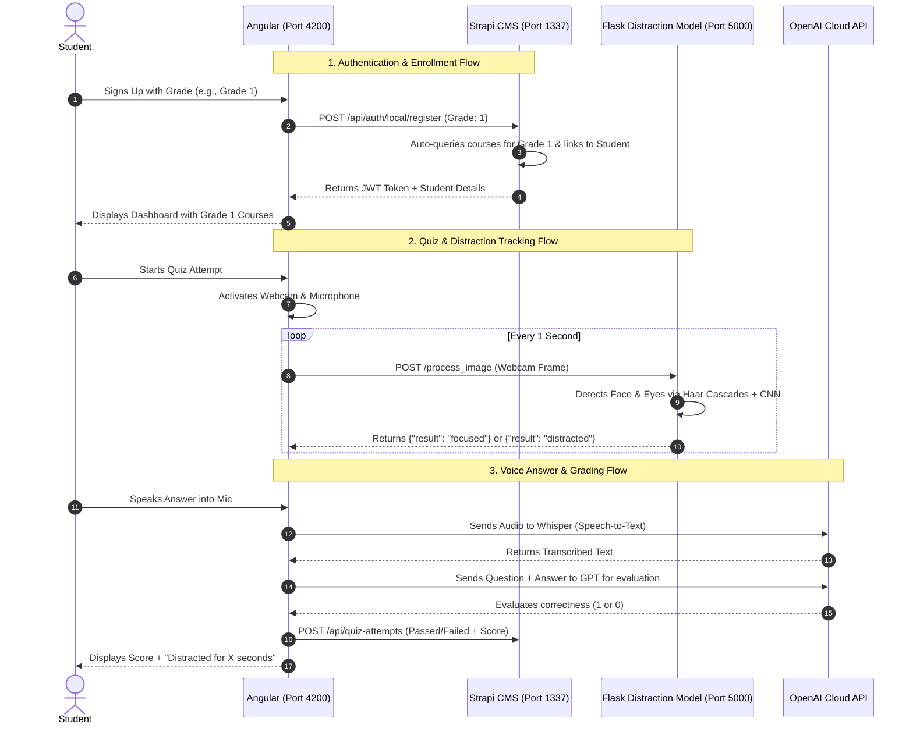

# Kids Learning Platform — Complete Functionality Testing & Flow Guide

Yeh document aapko project ki **tamam functionalities**, **credentials**, **system flow**, aur **step-by-step testing process** asaan aur exact tareeqay se batata hai taakay aap har feature ko locally test kar sakein.

---

## 1. System Credentials (Kahan aur Kya Hain?)

Project mein 2 tarah ke accounts tayyar hain:

### A. Student Account (Frontend Portal)
* **Login URL:** [http://localhost:4200/login](http://localhost:4200/login)
* **Email / Username:** `student@test.com`
* **Password:** `Password123`
* **Student Name:** Ali Ahmed
* **Grade:** Grade 1
* **Enrolled Courses:**
  1. *English Alphabet & Phonics*
  2. *Basic Math & Counting Fun*

---

### B. Admin Account (Strapi Backend CMS)
* **Admin URL:** [http://localhost:1337/admin](http://localhost:1337/admin)
* **Email:** `admin@test.com`
* **Password:** `Password123!`
* **Admin Name:** Admin Master
* **Purpose:** Yahan se aap courses, quizzes, questions, students, aur quiz attempts add, edit, ya delete kar sakte hain.

---

## 2. System Architecture & Flow

System 3 services par chalta hai jo aapas mein connect hoti hain:



---

## 3. Exact Steps: Har Functionality Kaise Test Karein

### STEP 1: Verify All 3 Services Are Running
Check karein ke teeno servers active hain:
1. **Frontend:** [http://localhost:4200](http://localhost:4200)
2. **Strapi Backend:** [http://localhost:1337](http://localhost:1337)
3. **Distraction Model API:** [http://127.0.0.1:5000](http://127.0.0.1:5000)

*(Agar future mein dobara chalana ho, terminal commands Section 5 mein hain).*

---

### STEP 2: Test Strapi Admin Panel (Content & Course Management)
1. Browser mein open karein: **[http://localhost:1337/admin](http://localhost:1337/admin)**
2. Credentials enter karein:
   - **Email:** `admin@test.com`
   - **Password:** `Password123!`
3. Left sidebar par **Content Manager** par click karein.
4. Yahan aapko ye collections milengi:
   - **Content:** Courses (English, Math, Science). Aap naya course add kar sakte hain with `tutorial_text`, `grade` (0 to 4), aur videos.
   - **Quiz:** Har course ke mutabiq quizzes.
   - **Question:** Quiz ke sawalat aur unke `reference_answer`.
   - **User:** Registered students aur unke enrolled courses.
   - **Quiz Attempt:** Students ke pass/fail results.

---

### STEP 3: Test Landing Page (Guest User View)
1. Browser mein open karein: **[http://localhost:4200/home](http://localhost:4200/home)**
2. Verify karein:
   - Top banner aur navigation bar ("Home", "Courses", "About Us", "Contact").
   - **Our Courses** section scroll karein: Strapi database se demo courses show ho rahe hain.
   - Top right par **Sign In** aur **Sign Up** buttons check karein.

---

### STEP 4: Test New Student Registration (Sign-Up)
1. Navigate karein: **[http://localhost:4200/sign-up](http://localhost:4200/sign-up)**
2. Form fill karein:
   - **First Name:** Muhammad
   - **Last Name:** Usman
   - **Email:** `usman@test.com`
   - **Password:** `Password123`
   - **Grade:** Choose Grade (e.g. `Grade 2` ya `Grade 3`)
3. **Register** button par click karein.
4. **Expected Result:**
   - Account create hoga aur student automatic login ho kar `/dashboard` par chala jayega.
   - Us student ko sirf uske chune hue Grade ke courses assign honge (e.g. Grade 2 student ko "Animals and Nature Discovery").

---

### STEP 5: Test Student Login
1. Navigate karein: **[http://localhost:4200/login](http://localhost:4200/login)**
2. Pre-made Student credentials daalein:
   - **Email:** `student@test.com`
   - **Password:** `Password123`
3. Click **Login**.
4. **Expected Result:**
   - Redirect to `http://localhost:4200/dashboard`.
   - Welcome message: *"Welcome back, Ali Ahmed!"*
   - Dashboard par 2 enrolled courses show honge:
     1. *English Alphabet & Phonics*
     2. *Basic Math & Counting Fun*

---

### STEP 6: Test Course Detail & Tutorial View
1. Dashboard par kisi bhi course card par click karein (ya sidebar mein **Courses** par click karein).
2. URL khulega: `http://localhost:4200/my/courses/1`
3. **Expected Result:**
   - Course title aur tutorial instructions display hongi.
   - Agar video attached hai to video player load hoga.

---

### STEP 7: Test Quizzes & AI Distraction Tracking (Webcam + Eye Gaze)
1. Sidebar mein **Quizzes** par click karein: `http://localhost:4200/my/quizzes`
2. Course ke sath **View Quizzes** button par click karein.
3. Quiz select karein (e.g. *Phonics & Letter Sounds Quiz*).
4. Quiz attempt screen khulegi (`/quiz`).
5. **Browser Webcam Permission:**
   - Browser webcam access mangay ga — **Allow** par click karein.
6. **Distraction Tracking Check:**
   - Background mein frontend har 1 second baad aapke face ka frame `http://localhost:5000/process_image` ko bhejta hai.
   - Model eye-cascade se dekhta hai ke student screen par dekh raha hai ya idhar udhar.
   - Agar aap screen se door dekhenge ya webcam se face hatayenge, to model `distracted` count increase karta hai.
7. **Answering the Question:**
   - Answer box mein text type karein ya **Microphone icon** click karke answer bolein.
   - Click **Next Question**.
8. **Quiz Completion:**
   - Aakhri question ke baad result alert display hoga:
     > *"You Were distracted for X sec."*
   - Score calculate hoga aur attempt backend par save hogi.

---

### STEP 8: Test Course Progress & Account Settings
1. **Progress Check:**
   - Sidebar mein **Progress** par click karein (`http://localhost:4200/my/progress`).
   - Completed quizzes aur performance percentage show hogi.
2. **Account Settings:**
   - Top right profile avatar ya sidebar se **Account Settings** par jayein (`http://localhost:4200/account-settings`).
   - First name, last name update karein aur password change test karein.

---

## 4. Third-Party APIs & Keys Status

| API / Service | Code File | Current Status & Action |
| :--- | :--- | :--- |
| **OpenAI API** | `frontend/src/app/components/quizzes/quizzes.service.ts` (Lines 54, 79) | Code mein ek purani key hardcoded hai (`sk-qiHc...`). Agar aap speech-to-text (Whisper) aur automatic AI grading use karna chahein, to yahan apni valid OpenAI API key daalein aur model `gpt-4o-mini` ya `gpt-3.5-turbo` set karein. |
| **AWS S3** | `backend/config/plugins.js` | Course video ya avatar upload ke liye AWS S3 config hai. Local testing ke liye bina AWS ke bhi platform chal raha hai. |
| **Amazon SES** | `backend/config/plugins.js` | Forgot-password emails ke liye. Local development mein password direct Admin panel se reset ho sakta hai. |

---

## 5. Startup Commands (Future Reference)

Agar aap computer restart karein ya services band ho jayein:

```powershell
# 1. Start Python Distraction API (Port 5000)
cd d:\Kids_Learning_Platform-master\distractionModel
py distraction_api.py

# 2. Start Strapi Backend CMS (Port 1337)
cd d:\Kids_Learning_Platform-master\backend
node server.js

# 3. Start Angular Frontend (Port 4200)
cd d:\Kids_Learning_Platform-master\frontend
npm run start
```
Browser mein open karein: **[http://localhost:4200](http://localhost:4200)**
